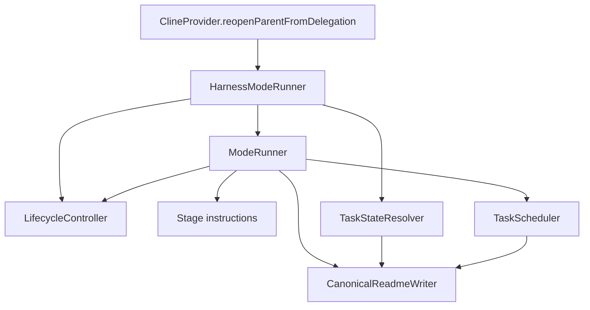

# Harness stage lifecycle model

This document describes the programmatic stage lifecycle that runs a task through its modes
(`sublimation` → `code` → `refactor` → `reviewer` → `qa`) without asking the model to choose the next
stage. `sublimation` is the entry mode: it is the only mode that owns `ANALYSIS`, so it is the only
mode that can start the cycle — the ordinary `architect` mode is outside the lifecycle vocabulary and
never routes it. It is a different model from the one in
[`docs/architecture/task-lifecycle-model.md`](task-lifecycle-model.md): that model covers the
persisted `HistoryItem` status of a _task record_ (active / delegated / completed / interrupted)
and is checked by `pnpm lifecycle:model-check`. This model covers the `Status` line of the task
README, which the modes act on. The two are connected only through
`ClineProvider.reopenParentFromDelegation`, which forks between them.

## Layers

| Layer              | Location                                                                                                         | Responsibility                                                                                                   |
| ------------------ | ---------------------------------------------------------------------------------------------------------------- | ---------------------------------------------------------------------------------------------------------------- |
| Integration        | [`ClineProvider.reopenParentFromDelegation`](../../src/core/webview/ClineProvider.ts:4415)                       | After a subtask child completes, delegate the next stage. Falls back to the legacy parent resume on any failure. |
| Adapter            | [`src/core/harness/mode-runner.ts`](../../src/core/harness/mode-runner.ts:21)                                    | Resolve the runtime `TaskContext`, parse the stage report, call the controller, apply the decision.              |
| Domain             | [`packages/core/src/lifecycle`](../../packages/core/src/lifecycle/index.ts:1)                                    | Pure routing (`LifecycleController`), effects (`ModeRunner`), protocol parsing (`parseStageOutcome`).            |
| Stage instructions | [`packages/core/src/lifecycle/stage-instructions.ts`](../../packages/core/src/lifecycle/stage-instructions.ts:1) | The declared artifacts and directive a stage start is composed from.                                             |
| Canonical state    | [`packages/core/src/worktree/task-state.ts`](../../packages/core/src/worktree/task-state.ts:36)                  | The status vocabulary, the failure-tracking fields, and the canonical transition table.                          |
| Canonical I/O      | [`packages/core/src/worktree/task-readme.ts`](../../packages/core/src/worktree/task-readme.ts:1)                 | The only writer of the harness-owned README block.                                                               |
| Stage modes        | [`DEFAULT_MODES`](../../packages/types/src/mode.ts:174)                                                          | The `sublimation`/`reviewer`/`qa`/`refactor` modes exist out of the box with their tool capabilities.            |

## The model has two halves, and they must agree

A stage outcome is only actioned when **both** halves agree:

1. **Preconditions** — `MODE_STATUSES` in [`lifecycle-controller.ts`](../../packages/core/src/lifecycle/lifecycle-controller.ts:24)
   answers "may this mode complete the status the README is currently in?".
2. **Canonical transitions** — `TASK_STATUS_TRANSITIONS` in [`task-state.ts`](../../packages/core/src/worktree/task-state.ts:36)
   answers "is the status we are about to write reachable from the current one?".

`LifecycleController.transition` validates every status it writes against the canonical table before
returning a decision, and a decision that re-writes the current status is treated as a no-op (the
runner skips the file write) instead of inventing self-loop edges. This is the invariant that keeps
the two halves from drifting:

> No status reaches the README unless it is an edge in `TASK_STATUS_TRANSITIONS`.

`schedule_implementation` is deliberately exempt: it defers the write to `TaskScheduler`, which
re-derives `IMPLEMENTATION` from the DAG after checking the status is an implementation stage.

Three edges exist only to close remediation loops, and they are the part of the table that is easy to
lose:

| Marker status | Written by                                      | Returns to                      | Meaning                                |
| ------------- | ----------------------------------------------- | ------------------------------- | -------------------------------------- |
| `REVIEW`      | reviewer `REQUIRED` / `PRODUCTION_FIX_REQUIRED` | `READY_FOR_REVIEW` → reviewer   | a fix pass is running; re-review it    |
| `REFACTOR`    | refactor `FUNCTIONAL_DEFECT`                    | `READY_FOR_REFACTOR` → refactor | a fix pass is running; re-refactor it  |
| `QA_READY`    | qa `FAILED`                                     | `REVIEW_PASSED` → qa            | a fix pass is running; re-verify in QA |

## Stage decisions

| Current status                   | Mode        | Outcome                               | Decision                                                                                                                      |
| -------------------------------- | ----------- | ------------------------------------- | ----------------------------------------------------------------------------------------------------------------------------- |
| `ANALYSIS`                       | sublimation | `COMPLETED`                           | stop at `PLAN_READY` when `requirePlanApproval` (default), else `schedule_implementation` → `READY_FOR_IMPLEMENTATION`        |
| `IMPLEMENTATION`                 | code        | `COMPLETED`                           | `schedule_implementation` → scheduler assigns the next ready unit, or `READY_FOR_REFACTOR` + refactor when every unit is done |
| `IMPLEMENTATION`                 | code        | `RESCHEDULE_REQUIRED`                 | park the unit (`IN_PROGRESS` → `TODO`), clear the assignment, `TaskScheduler.assignNext` recomputes the DAG                   |
| `READY_FOR_REFACTOR`, `REFACTOR` | refactor    | `COMPLETED`                           | `READY_FOR_REVIEW` + reviewer                                                                                                 |
| `READY_FOR_REFACTOR`, `REFACTOR` | refactor    | `FUNCTIONAL_DEFECT`                   | `REFACTOR` + code (fix pass)                                                                                                  |
| `READY_FOR_REVIEW`, `REVIEW`     | reviewer    | `PASSED`                              | `REVIEW_PASSED` + qa                                                                                                          |
| `READY_FOR_REVIEW`, `REVIEW`     | reviewer    | `REQUIRED`, `PRODUCTION_FIX_REQUIRED` | `REVIEW` + code (fix pass)                                                                                                    |
| `REFACTOR`, `REVIEW`, `QA_READY` | code        | `COMPLETED`                           | re-enters the requesting stage: `READY_FOR_REFACTOR` + refactor, `READY_FOR_REVIEW` + reviewer, or `REVIEW_PASSED` + qa       |
| `REVIEW_PASSED`, `QA_READY`      | qa          | `PENDING`                             | stop at `QA_READY` (waiting for the user)                                                                                     |
| `REVIEW_PASSED`, `QA_READY`      | qa          | `PASSED`                              | stop at `DONE`                                                                                                                |
| `REVIEW_PASSED`, `QA_READY`      | qa          | `FAILED`                              | `QA_READY` + code (fix pass)                                                                                                  |
| any owned status                 | any         | `BLOCKED`                             | stop at `BLOCKED` (external cause only; a schedulable cause must use `RESCHEDULE_REQUIRED`)                                   |

A fix pass never enters the implementation DAG: the status stays on the requesting stage's marker,
so `TaskScheduler.assignNext` refuses to assign a unit (it only assigns for implementation stages)
and the Code child works from the requesting stage's report instead of silently picking up unrelated
work.

## Two kinds of cause: reschedule vs block

A stage that cannot proceed must classify _why_, because the two causes have opposite effects on the
lifecycle:

- **Internal, schedulable cause** — the assigned unit is no longer runnable because a dependency on
  another implementation unit was discovered. The harness can remove this cause itself, so the stage
  reports `RESCHEDULE_REQUIRED`. The controller routes it to `reschedule_implementation`: the runner
  parks the unit (`IN_PROGRESS` → `TODO`, progress notes preserved in the artifact), clears the
  assignment (`READY_FOR_IMPLEMENTATION` + `Current Task: NONE`), and `TaskScheduler.assignNext`
  recomputes the DAG. The lifecycle keeps running; the parked unit becomes ready again once its
  dependency is `DONE`.
- **External, non-removable cause** — a user decision is needed, a credential is missing, an external
  service is unavailable, or the requirement is unclear. The harness cannot remove this cause, so the
  stage reports `BLOCKED`. The controller stops at `BLOCKED` and waits for a human.

Reporting `BLOCKED` for a schedulable cause is the deadlock this model exists to prevent: no stage
outcome leaves `BLOCKED` (`TASK_STATUS_TRANSITIONS.BLOCKED` has only the harness-owned resume edge)
and `TaskScheduler` only assigns units for implementation stages, so a dependency that is itself a
`TODO` unit can never complete while the task is blocked. The `code` stage directive states the
distinction where the stage is started.

## Resuming from BLOCKED

`BLOCKED` is not routable from a stage outcome: no stage result leaves it. It is left only by the
harness-owned resume action. `LifecycleController.resume(state, unblockConditionMet)` is pure, like
`transition`: the caller has already confirmed the `Unblock Condition` (a user signal or a verified
external event), which is why the confirmation is an explicit argument rather than something the
controller can observe.

The stop that writes `BLOCKED` also records the origin: the canonical `Blocked From` field carries
the status the task held before blocking. The resume returns the task to that origin instead of
always re-entering the implementation queue, so a task blocked during review or QA resumes into its
own stage instead of replaying the already-passed implementation pipeline:

| `Blocked From`                                                                  | Resume decision                                                                                                     |
| ------------------------------------------------------------------------------- | ------------------------------------------------------------------------------------------------------------------- |
| `READY_FOR_IMPLEMENTATION`, `IMPLEMENTATION`, or a legacy record with no origin | `resume_implementation`: write `READY_FOR_IMPLEMENTATION`, clear the assignment, `TaskScheduler` recomputes the DAG |
| `ANALYSIS`                                                                      | `start_mode` sublimation at `ANALYSIS`                                                                              |
| `READY_FOR_REFACTOR`, `REFACTOR`                                                | `start_mode` refactor at `READY_FOR_REFACTOR`                                                                       |
| `READY_FOR_REVIEW`, `REVIEW`                                                    | `start_mode` reviewer at `READY_FOR_REVIEW`                                                                         |
| `REVIEW_PASSED`, `QA_READY`                                                     | `start_mode` qa at `REVIEW_PASSED`                                                                                  |

A fix pass that was in flight when the task blocked (origin `REFACTOR`, `REVIEW`, `QA_READY`)
resumes as a re-verification by the requesting stage, with the failure budget preserved, so a
finding that comes back is counted against the same episode instead of restarting the loop. When
the controller returns the decision, `ModeRunner`:

1. writes the origin entry status and clears `Blocked From`;
2. reconciles the failure block (preserved for an in-flight fix pass, cleared otherwise);
3. for the implementation origin, clears `Current Task` (already `NONE` while blocked) and lets
   `TaskScheduler` recompute the DAG and assign the next ready unit, or move to Refactor when
   every unit is `DONE`.

The resume edges out of `BLOCKED` (`READY_FOR_IMPLEMENTATION`, `ANALYSIS`, `READY_FOR_REFACTOR`,
`READY_FOR_REVIEW`, `REVIEW_PASSED`) are declared in `TASK_STATUS_TRANSITIONS`, so a resume can
never write a status the canonical machine does not allow. A corrupted origin (`PLAN_READY`,
`DONE`, `BLOCKED` — statuses no stage can block from) is refused with `invalid` instead of guessed
at.

## Plan approval gate

`PLAN_READY` is the approval gate between analysis and implementation. When the gate is on, a
completed Sublimation stage stops here instead of handing straight to Code, so a human can review the
plan before any implementation unit is assigned. The gate is controlled by the `requirePlanApproval`
setting (default `true`); when it is off, the Sublimation stage keeps its historical
`schedule_implementation` decision and the task moves to `READY_FOR_IMPLEMENTATION` directly.

Like `BLOCKED`, `PLAN_READY` is not routable from a stage outcome: no mode runs while the task waits
for approval, so no stage result leaves it. It is left only by the harness-owned approve action.
`LifecycleController.approvePlan(state)` is pure, like `transition` and `resume`: it validates the
`PLAN_READY` → `READY_FOR_IMPLEMENTATION` edge against `TASK_STATUS_TRANSITIONS` and returns
`resume_implementation`, which `ModeRunner` applies by:

1. writing `READY_FOR_IMPLEMENTATION` and clearing `Current Task`;
2. letting `TaskScheduler` re-read the DAG from disk and assign the first ready unit, or move to
   Refactor when every unit is `DONE`.

The user may edit the plan artifacts before approving; because the scheduler re-reads the DAG from
disk, an approval always acts on the current plan rather than a snapshot taken at the stop. The
integration surfaces the gate as the `zoo-code.approvePlan` command and the `approvePlan` webview
message, and the stop notification points the user at that command.

The `PLAN_READY` → `READY_FOR_IMPLEMENTATION` edge is the only edge out of `PLAN_READY`; it is
declared in `TASK_STATUS_TRANSITIONS`, so an approval cannot write a status the canonical machine
does not allow. If the DAG has no ready unit after approval (for example the user broke it while
editing), the task stays at `READY_FOR_IMPLEMENTATION` with `Current Task: NONE` — the canonical
resumable state — and the user retries through the "continue lifecycle" command
(`zoo-code.continueTaskLifecycle`).

## QA confirmation gate

`QA_READY` is the confirmation gate at the end of the chain: the `qa` stage stops there with `PENDING`
because the recorded evidence (qa.md) needs a human confirmation before the task may finish. Like
`PLAN_READY`, the gate is harness-owned — the deterministic exit is the approve action, not a re-run
of the `qa` stage until it reports `PASSED`. `LifecycleController.approveQa(state)` is pure, like
`approvePlan`: it validates the `QA_READY` → `DONE` edge against `TASK_STATUS_TRANSITIONS` and returns
the `DONE` stop, which `ModeRunner` applies by clearing `Current Task` and the failure tracking.

The integration surfaces the gate as the `zoo-code.approveQa` command and the `approveQa` webview
message, and the stop notification points the user at that command. A task that is not at `QA_READY`
is refused unchanged, so a stale call cannot finish the task early.

## The report protocol

A stage reports its semantic outcome with exactly one `Stage Result: <RESULT>` line. The marker is
the exported constant `STAGE_RESULT_MARKER`, and both sides are derived from it: the instruction
`ModeRunner` sends and the pattern `parseStageOutcome` matches. The mode itself is never taken from
the reply — it comes from the runtime child history — so a model cannot route the lifecycle.

A failing stage may additionally name the finding it could not satisfy with one optional
`Failure Key: <id>` line (`STAGE_FAILURE_KEY_MARKER`). The id is the model's to choose; everything
that follows from it is the harness's.

`NOT_APPLICABLE` is not a stage outcome: it is the defensive report of a stage that observed a
status its stage does not own and did nothing. The parser accepts it — so the reply is not
mistaken for a lost marker and the re-ask does not fire — and the controller refuses it for every
mode, which sends the caller to the state-only continue: the harness routes the task from the
canonical state instead of trusting the report.

Parsing is deliberately strict: an unknown mode, an unknown result, a missing marker, more than one
marker line, or more than one failure-key line all yield `null`, which sends the caller down its
pre-existing parent-resume path. The one tolerated deviation is trailing punctuation on the result
token (`Stage Result: COMPLETED.` is a common near-miss); the failure key is compared for identity
exactly as written and never stripped.

### The bounded marker re-ask

A reply without the marker is a lost report: the state-only continue cannot know a finding the
stage never named, and falling back silently would drop the outcome of real stage work. Before
degrading, `ClineProvider.reopenParentFromDelegation` asks the same mode once to re-report —
`buildStageReaskInstruction` composes a pointer that names the artifacts, forbids redoing the work,
and asks for the same marker line. The bound is the `STAGE_RE_ASK_PREFIX` on the delegated message:
a re-ask child whose reply again lacks the marker is never re-asked again; it falls to the
state-only continue and then the legacy resume. A reply that _contains_ the marker but fails to
parse (duplicated markers, an unknown result) is treated as ambiguity, not absence — asking again
would not cure it, so the re-ask does not fire.

## The stage instruction

The message that starts a stage is a pointer, not a payload. `buildStageInstruction` composes it from
`STAGE_ARTIFACTS` (the paths relative to the task artifact directory the stage works from) and
`STAGE_DIRECTIVES` (one line describing the stage's responsibility). The assigned implementation unit
is appended as a task-relative path when one exists, and a fix pass adds the failure line so the stage
repeats the same key. Canonical README state already reaches every mode through the system prompt, so
it is not duplicated here. Adding a stage is a row in those two tables, not new prose in the runner.

## Failure tracking and the attempt budget

The README carries the harness-owned failure fields: `Failure Key`, `Failure Attempts`, and the
episode counter `Total Failure Attempts`. The controller — never the model — owns all three:

- A fix-pass decision (`reviewer` `REQUIRED`/`PRODUCTION_FIX_REQUIRED`, `refactor`
  `FUNCTIONAL_DEFECT`, `qa` `FAILED`) attributes the pass to `outcome.failureKey ?? state.failureKey`
  and increments both counters. A different key starts a fresh per-key count of `1`; a missing key
  still forms its own bucket (stored as the canonical `NONE`), so an unnamed loop is bounded by the
  same budget. The total advances on every pass regardless of key, so relabelling the same finding
  with a fresh key cannot reset the episode budget.
- A completed fix pass preserves the tracking while the requesting stage re-verifies, so a finding
  that comes back is counted against the same key and episode instead of restarting the loop.
- Every other decision advances the lifecycle and clears the block (`NONE` / `0` / `0`), so the
  total bounds one remediation episode, not the whole task history.

When the next pass would exceed `MAX_FAILURE_ATTEMPTS`, the controller does not start it: it
returns `stop` at `BLOCKED` with reason `max-attempts`, carrying the exhausted key and the spent
count so the user sees exactly which finding blocked the task. When it would exceed
`MAX_TOTAL_FAILURE_ATTEMPTS` (the budget across every key in the episode), it stops with reason
`max-total-attempts` instead — the bound against key churn. Both budgets are code constants,
never prompt instructions, so they hold even when the model keeps proposing the same remedy or
keeps renaming it.

## Mode capabilities

The lifecycle modes are built-in (`DEFAULT_MODES`), so `startMode` finds `sublimation`, `reviewer`,
`qa`, and `refactor` without project configuration; custom modes still override them, because
`getModeBySlug`
consults custom modes first. `sublimation` is the built-in entry mode: its instructions carry the
stage-report protocol, so a task started in it runs the analysis stage and hands the chain to the
harness, while the ordinary `architect` mode plans without ever routing the lifecycle. Capability
enforcement uses the existing tool-group mechanism rather than
a new one: `reviewer` and `qa` get `read`, `command`, and an `edit` group restricted to `\.md$`, so a
reviewer that tries to touch production code is rejected with `FileRestrictionError`. `refactor` gets
the full `edit` and `command` groups. This is the runtime half of "reviewer must not modify production
code": the rule is still worth stating in the mode's instructions, but the tool is not available to
violate it.

## Failure semantics

Everything that can go wrong degrades to the legacy behaviour instead of failing the task:

| Failure                                                    | Result                                                                                                                               |
| ---------------------------------------------------------- | ------------------------------------------------------------------------------------------------------------------------------------ |
| Not a lifecycle mode, or no unambiguous report             | One bounded re-ask child (`buildStageReaskInstruction`); a second marker-less reply returns `null` and the parent resumes as before. |
| Mode/status mismatch, or a non-canonical status transition | `invalid`; the parent resumes as before.                                                                                             |
| Selected mode is not configured                            | `startMode` throws `LifecycleError`; the parent resumes as before.                                                                   |
| README has no canonical `Status` line                      | `LifecycleError`; the parent resumes as before.                                                                                      |
| Scheduler cannot produce a next stage                      | `invalid`; the parent resumes as before.                                                                                             |
| Approval with no ready unit (DAG broken by an edit)        | task stays at `READY_FOR_IMPLEMENTATION` + `Current Task: NONE`; retry via the "continue lifecycle" command.                         |

| Attempt budget exhausted (`max-attempts` / `max-total-attempts`) | `stop` at `BLOCKED`; the parent resumes as before. |

## Where the invariants are enforced

| Invariant                                                                        | Enforced by                                                                                                                                                                    |
| -------------------------------------------------------------------------------- | ------------------------------------------------------------------------------------------------------------------------------------------------------------------------------ |
| No status is written outside `TASK_STATUS_TRANSITIONS`                           | `LifecycleController.transition`                                                                                                                                               |
| A mode only completes a status its stage owns                                    | `MODE_STATUSES` precondition check                                                                                                                                             |
| Every status a mode claims can actually be routed                                | controller spec, `claims only stage/status pairs that can actually be routed`                                                                                                  |
| Every decision the cross-product can produce is canonical                        | controller spec, `only ever writes canonical task status transitions`                                                                                                          |
| The instruction and the parser agree on the marker                               | `packages/core/src/lifecycle/__tests__/mode-runner.spec.ts`, `asks the stage for the outcome marker the parser reads back`                                                     |
| Only one writer mutates the README block                                         | `CanonicalReadmeWriter` is the sole read-modify-write path for `ModeRunner`; `TaskScheduler` uses the same field writer and atomic write                                       |
| The canonical README is read-only for model tools outside `ANALYSIS`             | `evaluateArtifactMutationGate` (`src/core/harness/lifecycle-gate.ts`) rejects the artifacts-root README in every non-`ANALYSIS` status                                         |
| A schedulable cause never stops the lifecycle                                    | `LifecycleController.decide` routes `code` + `IMPLEMENTATION` + `RESCHEDULE_REQUIRED` to `reschedule_implementation`; only `BLOCKED` stops                                     |
| A parked unit returns to the DAG                                                 | `parkImplementationTask` rewrites `IN_PROGRESS` → `TODO`; `readyTasks` re-includes it once its dependency is `DONE`                                                            |
| A reschedule cannot loop on the same unit                                        | `ModeRunner` refuses a reschedule that left the parked unit ready                                                                                                              |
| `BLOCKED` resumes only through the harness action                                | `LifecycleController.resume` requires the Unblock Condition and returns the canonical `BLOCKED` → origin edge                                                                  |
| A resume returns to the origin stage, not the pipeline start                     | controller spec, `resumes a task blocked at its ... stage entry back into that stage`; the origin is recorded as `Blocked From` on the stop                                    |
| The marker re-ask is bounded to one attempt                                      | `requestStageOutcomeReask` refuses when the completed child's task record starts with `STAGE_RE_ASK_PREFIX`                                                                    |
| The episode budget holds against key churn                                       | `startFixPass` advances `Total Failure Attempts` on every key; controller spec, `stops at BLOCKED once the episode budget is exhausted across keys`                            |
| `PLAN_READY` is left only through the harness action                             | `LifecycleController.approvePlan` returns the canonical `PLAN_READY` → `READY_FOR_IMPLEMENTATION` edge; no stage outcome leaves `PLAN_READY`                                   |
| `QA_READY` is finished only through the harness action or a passing `qa` outcome | `LifecycleController.approveQa` returns the canonical `QA_READY` → `DONE` edge; the stop notification points the user at `zoo-code.approveQa`                                  |
| `DONE` is absorbing and every reachable state can still reach it                 | `scripts/check-harness-stage-lifecycle.ts` (via `pnpm lifecycle:model-check`) explores every stage-outcome/action interleaving                                                 |
| The queue opening on a drained DAG enters Refactor canonically                   | `READY_FOR_IMPLEMENTATION` → `READY_FOR_REFACTOR` edge in `TASK_STATUS_TRANSITIONS`; `scripts/check-harness-stage-lifecycle.ts` proves the scheduler continuation is canonical |

## `Next Step` ownership

`Next Step` is a human-facing pointer in the README, not a routing input. Two writers keep it current,
both through the shared field writer:

- `TaskScheduler` writes `Implement Txx (...)` when it assigns an implementation unit.
- `ModeRunner` refreshes it in the same canonical write as `Status` on every transition it owns: a
  `stop` writes a status-derived pointer (`PLAN_READY` → approve the plan, `QA_READY` → confirm the QA
  outcome, `BLOCKED` → resolve the blocker, `DONE` → the lifecycle is complete), and a `start_mode`
  names what is running — `Run the <mode> stage.` for an ordinary start, `Run the code fix pass for
<finding> (attempt N).` for a fix pass, or `Re-run the <mode> stage to verify the fix for
<finding>.` for a re-verification — so a human reading the README can tell a fix pass from an
  ordinary stage run even on the ambiguous `QA_READY` marker.

The runner passes `undefined` for the decisions that continue the DAG (`schedule_implementation`,
`reschedule_implementation`, `resume_implementation`), so the scheduler's assignment pointer is never
overwritten. The wording is deterministic and status-derived, and the existing diff logic keeps an
idempotent re-write byte-identical.

## Extending the model

- **New edge between stages** — add it to `TASK_STATUS_TRANSITIONS` and update the controller spec
  table. The cross-product guard will fail until the decision is written. The parking edge
  (`IMPLEMENTATION` → `READY_FOR_IMPLEMENTATION`) is a lifecycle edge, not a remediation marker: it
  returns an unready unit to the queue instead of starting a fix pass.
- **New stage outcome** — add the result to `STAGE_RESULTS`, handle it in `LifecycleController.decide`
  (the exhaustive `switch` makes an unhandled result a type error), then extend the spec tables.
- **New canonical README field** — add it to `CANONICAL_README_FIELDS` in `task-readme.ts` so both
  writers stay consistent, extend `readCanonicalFields` and the resolver, and pass it explicitly from
  each caller. A field that no writer sets must be inserted by naming a canonical sentinel, because
  the writer replaces and inserts but never deletes.
- **New stage** — add the mode to `LIFECYCLE_MODES`, give it a row in `MODE_STATUSES`, a capability
  profile in `DEFAULT_MODES`, and a row in `STAGE_ARTIFACTS`/`STAGE_DIRECTIVES`. The routability guard
  requires at least one real outcome to be handled for every claimed status.
- **New attempt policy** — change `MAX_FAILURE_ATTEMPTS` or the attribution rule in `startFixPass`;
  everything downstream persists whatever the controller returns.

Do not add a second writer for the README block or a second source of transition truth; the drift
guards exist because the two halves of this model were previously maintained separately.
