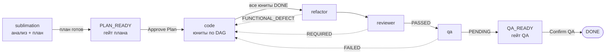

# Task Harness — программный конвейер задач

Харнесс проводит задачу через фиксированный конвейер стадий — **sublimation → code → refactor → reviewer → qa** — не спрашивая модель, каким этапом заняться дальше. Маршрутизацией владеет харнесс: модель делает работу одной стадии и репортит ровно одну строку с результатом, а харнесс решает, что дальше.

Одна задача = одна Git-ветка = одна папка задач. Харнесс определяет задачу по имени ветки, создаёт папку, ведёт состояние в каноническом README и делегирует каждую стадию соответствующему режиму. Человеческие гейты (подтверждение плана, подтверждение QA) останавливают цепочку ровно там, где нужно решение человека.

## Быстрый старт

1. **Ветка с ID задачи.** Создайте ветку, в имени которой есть Jira-подобный ID: `feature/SITESUP-1234-fix-login`. Паттерн ID — `[A-Z][A-Z0-9]+-\d+`. Если совпадения нет, харнесс использует санитизированное имя ветки как ID (ветка без ID не ломает запуск).
2. **Запустите задачу в режиме Sublimation.** Это единственный режим, который запускает lifecycle. Обычный `architect` планирует, но никогда не запускает конвейер.
3. **Подтвердите план.** По умолчанию (настройка «Require plan approval», включена) после анализа задача останавливается на статусе `PLAN_READY`. Проверьте и при необходимости отредактируйте артефакты плана — при подтверждении харнесс перечитает DAG с диска, так что подтверждение действует на текущий план, а не на снимок на момент остановки. Затем выполните команду **Zoo Code: Approve Plan** (или нажмите кнопку в чате).
4. **Цепочка идёт.** Реализация (юниты по DAG) → рефакторинг → ревью → QA. Гейты, зависшие стадии и блокировки — ниже.
5. **Подтвердите QA.** Стадия qa записывает доказательства в `qa.md` и останавливается на `QA_READY`. Команда **Zoo Code: Confirm QA** завершает задачу (`DONE`).

## Идентификация задачи и артефакты

Папка задачи: `<корень workspace>/.roo/tasks/<taskId>/`.

| Путь                        | Кто пишет         | Назначение                                                                                                              |
| --------------------------- | ----------------- | ----------------------------------------------------------------------------------------------------------------------- |
| `README.md`                 | только харнесс    | Канонический блок состояния: `Status`, `Current Task`, `Next Step`, счётчики неудач                                     |
| `implementation-plan.md`    | sublimation       | План реализации                                                                                                          |
| `implementation/T01-*.md`   | sublimation → code | Юниты реализации: `Status` (TODO / IN_PROGRESS / DONE), зависимости, заметки о прогрессе                                 |
| `handoff.md`                | стадии            | Передача работы между стадиями                                                                                           |
| `qa.md`                     | qa                | Доказательства: для каждого результата точная команда плюс ссылка на CI-прогон (или вывод тестов), 3 варианта commit message |

Открытые рекомендации reviewer выносит в бэклог воркспейса `.roo/backlog.md` — они переживают папку задачи.

## Конвейер стадий

| Стадия       | Режим      | Работает с                                | Ответственность                                                                       |
| ------------ | ---------- | ----------------------------------------- | ------------------------------------------------------------------------------------- |
| Анализ       | sublimation | `README.md`                               | Собрать контекст, создать `implementation-plan.md` и юниты в `implementation/`       |
| Реализация   | code        | `README.md`, назначенный юнит            | Реализовать назначенный юнит или fix-pass                                             |
| Рефакторинг  | refactor    | `README.md`, `implementation/`            | Перестроить готовую реализацию, не меняя поведение                                    |
| Ревью        | reviewer    | `README.md`, `implementation/`, `handoff.md` | Проверить реализацию против требований, зафиксировать замечания                   |
| QA           | qa          | `README.md`, `handoff.md`, `qa.md`        | Проверить критерии приёмки, записать доказательства                                   |

## Гейты и команды

| Команда палитры                            | ID                                 | Что делает                                                                          |
| ------------------------------------------ | ---------------------------------- | ------------------------------------------------------------------------------------ |
| Zoo Code: Approve Plan                     | `zoo-code.approvePlan`             | Гейт плана: выйти из `PLAN_READY` и начать реализацию                                 |
| Zoo Code: Confirm QA                       | `zoo-code.approveQa`                | Гейт QA: завершить задачу из `QA_READY` (`DONE`)                                     |
| Zoo Code: Continue Task Lifecycle          | `zoo-code.continueTaskLifecycle`    | Продолжить цепочку из канонического состояния                                        |
| Zoo Code: Resume Blocked Task             | `zoo-code.resumeBlockedTask`        | Выйти из `BLOCKED` после снятия блокера                                              |
| Zoo Code: Force-Advance Stuck Stage       | `zoo-code.approveStage`             | Принудительно завершить стадию, зависшую в цикле без отчёта                           |
| Zoo Code: Open Harness Log Viewer         | `zoo-code.openHarnessLogViewer`     | Веб-просмотр логов харнесса в браузере (только 127.0.0.1, токен на каждый старт)     |
| Zoo Code: Register Harness Log MCP Server  | `zoo-code.registerHarnessLogsMcp`   | Доступ к логам через MCP                                                             |

Когда задача останавливается на гейте, кнопки появляются и в чате.

Настройка: **Settings → Auto-Approve → «Require plan approval»** (включена по умолчанию). Выключите — и после анализа харнесс пойдёт сразу в реализацию, без остановки на `PLAN_READY`.

## Как это работает

### Протокол отчёта стадии

Каждая стадия заканчивает работу ровно одной строкой `Stage Result: <RESULT>`; опционально добавляется `Failure Key: <id>` — какое замечание не удалось закрыть. Результаты по стадиям:

- sublimation: `COMPLETED`, `BLOCKED`
- code: `COMPLETED`, `RESCHEDULE_REQUIRED`, `BLOCKED`
- refactor: `COMPLETED`, `FUNCTIONAL_DEFECT`, `BLOCKED`
- reviewer: `PASSED`, `REQUIRED`, `PRODUCTION_FIX_REQUIRED`, `BLOCKED`
- qa: `PASSED`, `PENDING`, `FAILED`, `BLOCKED`

Харнесс парсит маркер, проверяет переход по канонической таблице и пишет следующий статус. Режим берётся из рантайма (из истории дочерней задачи), а не из ответа модели — модель не может маршрутизировать lifecycle.

### Fix-проходы и бюджеты

Провал ревью, QA или рефакторинга запускает fix-pass: код чинит замечание, стадия-заказчик перепроверяет. Бюджеты — константы в коде, не инструкции в промпте, поэтому они действуют, даже если модель настойчиво предлагает одно и то же лекарство:

- **3 попытки** на один ключ замечания (`MAX_FAILURE_ATTEMPTS`) и **6 суммарно** на эпизод (`MAX_TOTAL_FAILURE_ATTEMPTS`). Переименование ключа не сбрасывает эпизод — суммарный счётчик растёт на каждый проход.
- Исчерпание бюджета → остановка в `BLOCKED` с указанием, какой именно finding исчерпал попытки.
- Стадия, которая раз за разом завершается без маркера отчёта: после **3 рестартов** (`MAX_MARKER_LESS_STAGE_RESTARTS`) цепочка ставится на паузу, и предлагается **Force-Advance Stuck Stage** — принудительное завершение стадии от вашего имени, через те же канонические переходы.

### RESCHEDULE_REQUIRED против BLOCKED

Причина нехватки прогресса бывает двух видов, и эффект у них противоположный:

- **Внутренняя, устранимая** — назначенный юнит не может идти, пока не готов зависимый юнит. Стадия репортит `RESCHEDULE_REQUIRED`: юнит паркуется (`IN_PROGRESS` → `TODO` с сохранением заметок), DAG пересчитывается, lifecycle продолжается сам.
- **Внешняя, неустранимая** — нужно решение пользователя, отсутствуют креды, недоступен внешний сервис. Стадия репортит `BLOCKED`: цепочка останавливается и ждёт человека. `BLOCKED` не покидается результатом стадии — только командой **Resume Blocked Task**, причём задача возвращается в стадию происхождения (поле `Blocked From`), а не в начало конвейера: задача, заблокированная на ревью, после снятия блокера попадёт обратно на ревью, а не будет заново проходить реализацию.

Репорт `BLOCKED` по устранимой причине — это дедлок, против которого модель и существует: ни один результат стадии не выводит из `BLOCKED`, а планировщик назначает юниты только на стадиях реализации, так что зависимость-`TODO` никогда не закрылась бы сама.

### Гарантии

- Статус в README пишет только харнесс, и только если переход есть в канонической таблице `TASK_STATUS_TRANSITIONS`; повторная запись того же статуса — no-op.
- `DONE` поглощающий и достижим из любого достижимого состояния — проверяется прогоном `pnpm lifecycle:model-check`, который исследует все interleaving стадий и действий.
- Reviewer и QA не могут править продакшн-код: их edit-инструменты ограничены файлами `\.md$` (попытка отклоняется `FileRestrictionError`).
- Канонический `README.md` задачи доступен инструментам модели только на чтение вне стадии анализа (artifact-mutation gate).
- Любой сбой (неизвестный режим, непарсящийся отчёт, неканонический статус) деградирует в легаси-поведение — родительская задача возобновляется как раньше, — а не роняет задачу.

## Глубокое погружение

Полная модель — таблица переходов, инварианты и где что проверяется:
[docs/architecture/harness-stage-lifecycle-model.md](architecture/harness-stage-lifecycle-model.md).

Проверка инвариантов модели: `pnpm lifecycle:model-check`.
